# DMA-2026 — Practical work 5: layouts and their combination

Semyon Butuzov (yorushi), group P24-3.2 · assignment: [`task_5.md`](https://github.com/U5er01Task/DMA-2026/blob/main/task_5.md)

All **80 items** are implemented in one app, the `:task5` module (`dev.yorushi.dma.task5`): the
**30 topic exercises** (topics 1–6, five each) and the **50 mixed screens**. Topic 7 has no
exercises of its own; it is applied to every screen and to item 50 in particular, and measured
(see [Topic 7](#topic-7-optimisation-measured)). The app opens on a menu with a button for every item.

| | |
|---|---|
| Items implemented | 80 / 80 (81 screens: exercise 6.5 asks for two) |
| Unit tests | 8, the logic behind the interactive items (JUnit 4, JVM) |
| Instrumented tests | 88 on an Android 15 emulator: every screen opens; 65 check the geometry each layout promises; 20 user scenarios; 1 checks the window backgrounds |
| Lint | 0 errors; hardcoded text in code or layouts is a build error |
| Compiler | `javac -Xlint:all`, no warnings |
| Interface language | Russian (the screens model Russian apps: roubles, Moscow → Saint Petersburg) |

## Running it

```bash
cd dma-tasks
./gradlew :task5:assembleDebug :task5:lintDebug   # build; lint fails on any hardcoded text
./gradlew :task5:testDebugUnitTest                # 8 unit tests, no device needed
./gradlew :task5:connectedDebugAndroidTest        # 88 instrumented tests, needs a device
./gradlew :task5:installDebug                     # then open "DMA Task 5"
```

## Screenshots

Terminal output was captured from real runs and rendered unchanged; the phone screens were taken
by the instrumented tests themselves (`Shots.take`) right after their checks passed.

**Compilation and lint** — clean build, no compiler warnings, no lint errors:

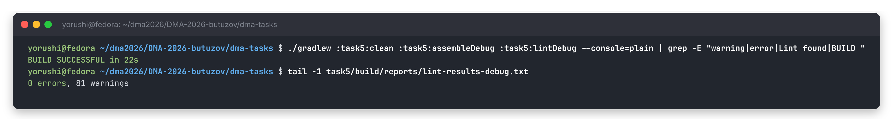

**Unit tests:**

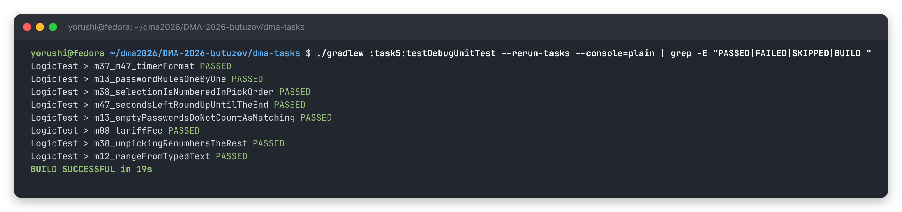

**Instrumented tests** — through Gradle, then directly with `am instrument`:

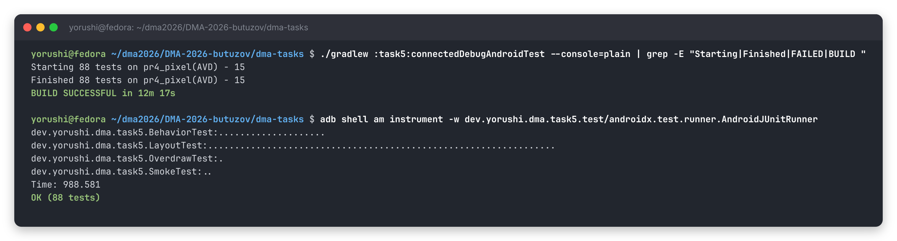

**The app.** Topics 1–6:

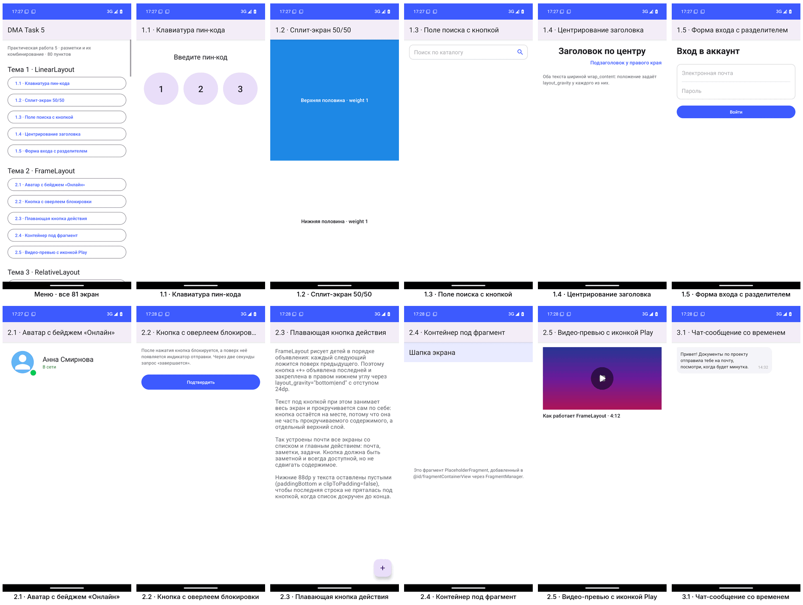

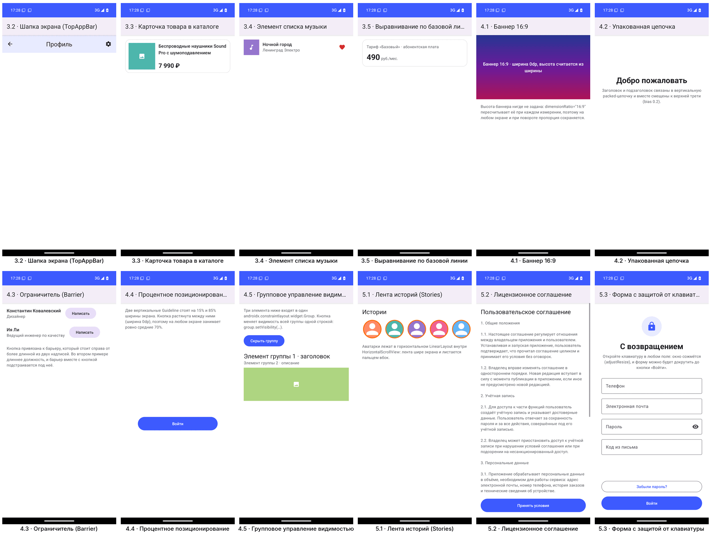

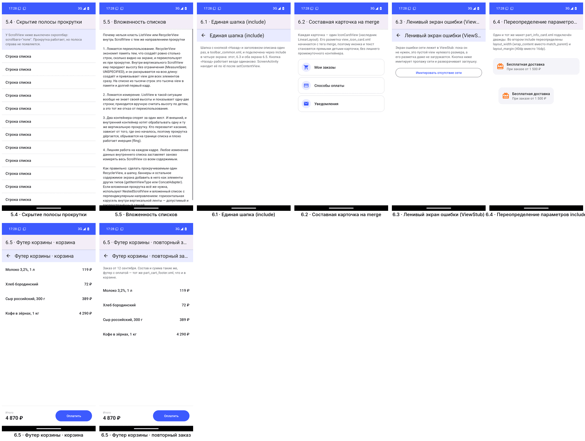

The 50 mixed screens:

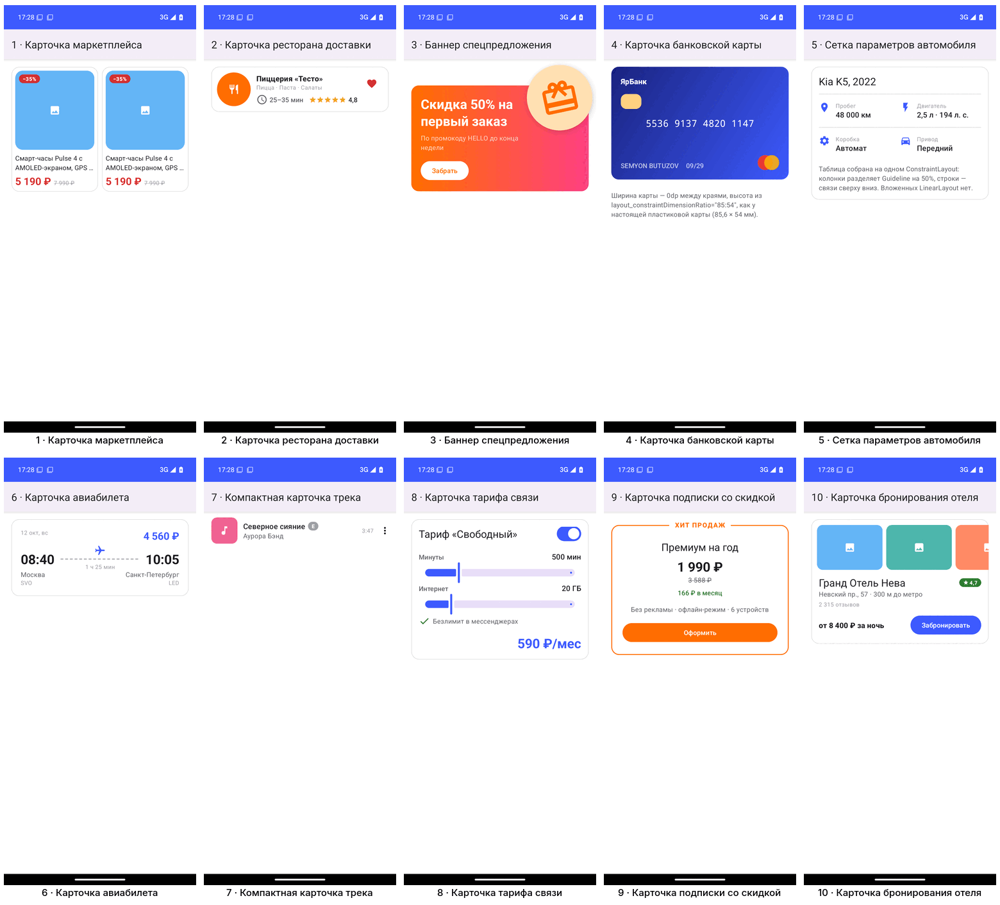

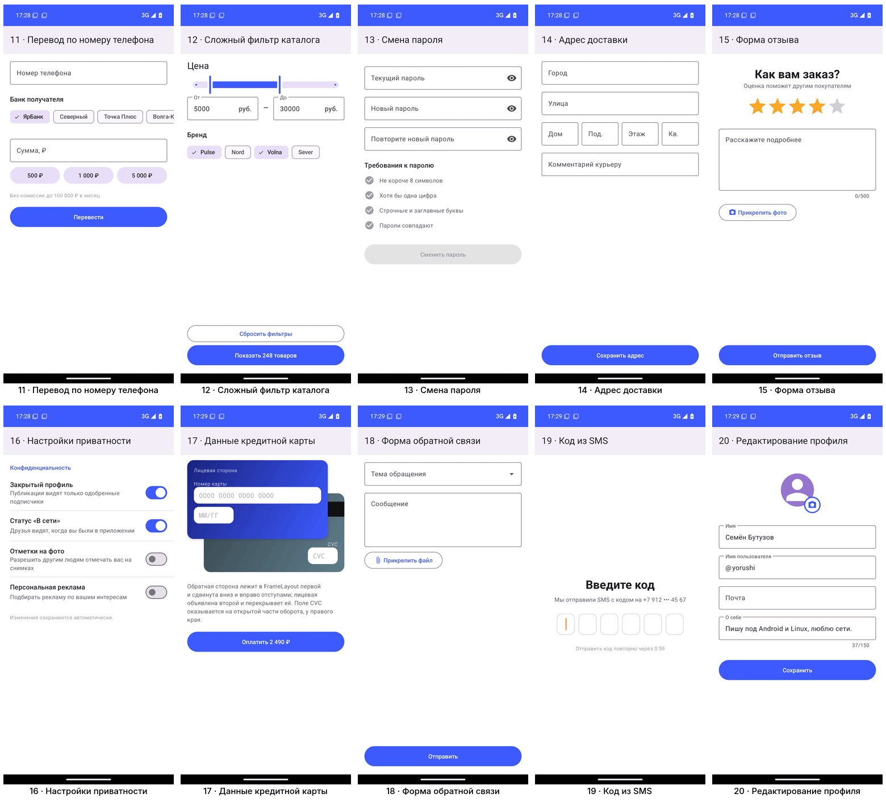

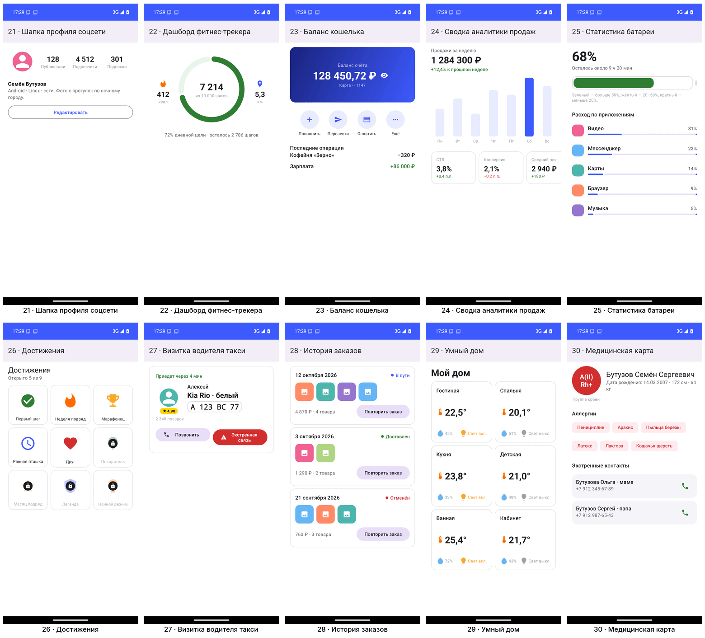

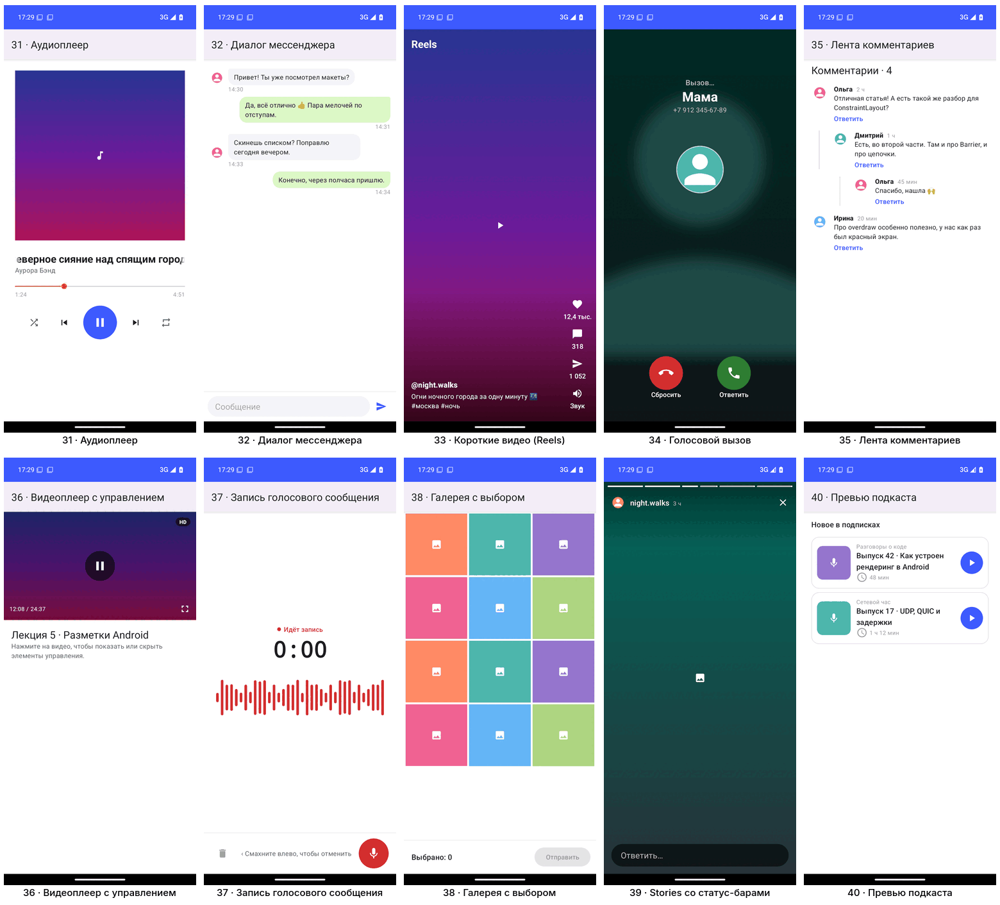

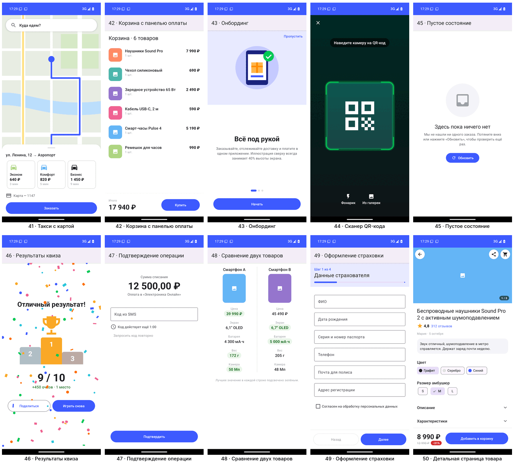

**Interactive items**, each shot taken in the state its scenario test has just checked:

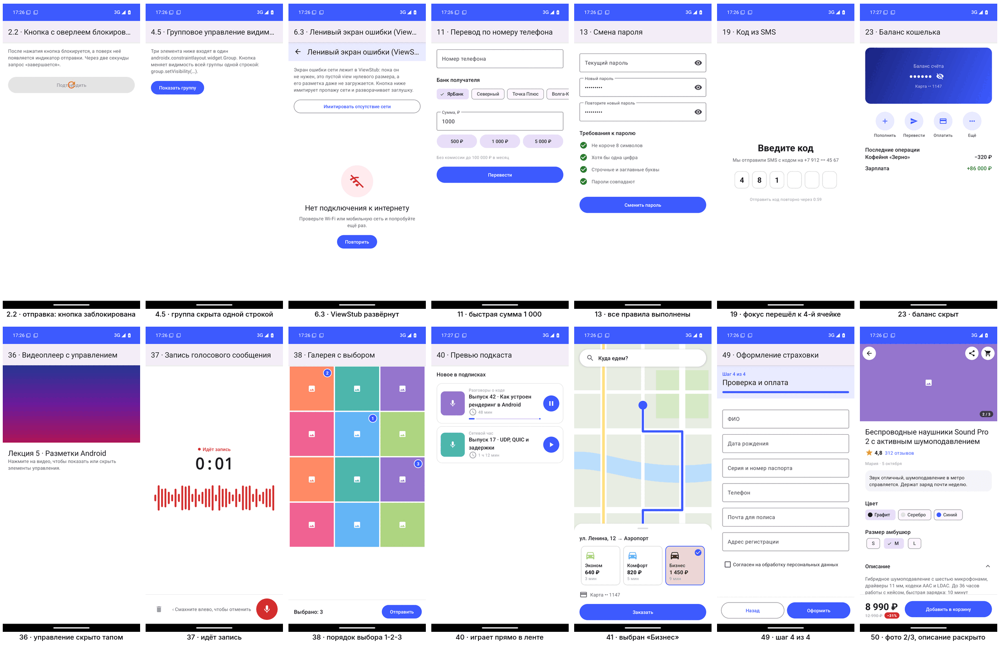

## Project layout

```
task5/src/
├── main/java/dev/yorushi/dma/task5/
│   ├── MainActivity.java      the menu
│   ├── Catalog.java           every item: label, title, layout, behaviour, full-screen flag
│   ├── ScreenActivity.java    shows one item; shared toolbar wiring; drops a hidden window background
│   ├── Behaviors.java         the code of the 22 interactive items
│   ├── logic/                 PasswordRules, SelectionOrder, Countdown, Tariff, PriceRange: pure Java
│   └── widget/                SquareButton, SquareFrameLayout, IconCardView (merge), BarChartView,
│                              WaveformView, ScannerOverlayView, ConfettiView
├── main/res/layout/           one XML layout per item (t1_1_… for topics, m01_… for mixed items),
│                              plus the shared parts: toolbar_common, part_cart_footer, part_info_card,
│                              part_marketplace_card, view_icon_card (merge), stub_no_internet
├── main/res/values/           strings per section, colours, dimens, styles (T5.*)
├── test/                      LogicTest (JVM)
└── androidTest/               SmokeTest, LayoutTest, BehaviorTest, OverdrawTest, Shots, Screens
```

## How the containers were chosen

The assignment's own table (topic 7) was the rule:

- **ConstraintLayout** for anything with more than a couple of related elements: cards (2, 4–8,
  21–23, 27, 31, 36, 37), whole screens that centre or chain (19, 43, 45, 46, 47) and tables (5, 48).
  Chains, barriers, guidelines, ratios and percentages replace nested rows and columns, so 15 of the
  50 mixed screens are a **single flat level** and item 5's spec table has no nested layout at all.
- **LinearLayout** for plain stacks and for proportional rows with weights: the PIN row (1.1), the
  50/50 split (1.2), the address row 1:1:1:1 (14), quick sums (11), story segments (39), Back/Next (49),
  grid rows of square tiles (26, 29, 38). Weights are never nested inside weights.
- **FrameLayout** only where the point is layering: badges and overlays (2.1, 2.2, 2.5, 1, 9, 20),
  a FAB (2.3), fragment host (2.4), full-screen media with controls on top (33, 34, 39, 44, 46), a list
  under a fixed panel (42), the product page (50).
- **RelativeLayout** only in topic 3, where it is the subject, and in two small contact rows (30).
- **ScrollView** holds one child and never a list that scrolls the same way (answer 5.5); fixed bars
  are siblings of the ScrollView, never inside it (5.2, 42, 49, 50).
- **include / merge / ViewStub** wherever a part repeats or is rarely needed: the shared toolbar on four
  screens (6.1), the cart footer on two (6.5), the marketplace card twice in a row (1), a compound
  view with a `merge` root (6.2), the offline screen (6.3).

### Deliberate interpretations

| Item | Decision |
|---|---|
| 1.1 | Round buttons that share the row by weight: `SquareButton` makes each as tall as its weighted width, a 50% corner makes it round. |
| 2.4 | The empty container is real: a fragment is committed into `@id/fragmentContainerView`. |
| 4.3, 6.4 | Each shown twice, so both cases are visible: the name longer / the role longer; full width / overridden width and margin. |
| 5.5 | The written answer is a screen of the app (full text below). |
| 6.1 | The shared toolbar is included in four screens (6.1, 6.3 and both 6.5 screens). |
| 6.5 | Two screens, cart and repeat order, share `part_cart_footer.xml`. |
| 22, 24, 37, 44, 46 | The ring is `CircularProgressIndicator`; the week chart, the waveform, the scanner window and the confetti are small custom views drawing on a canvas. |
| 34 | The caller's photo is blurred with `RenderEffect` (Android 12+); older systems get a dimmed photo. |
| 41 | The map underlay and the sheet live in a `CoordinatorLayout` (a FrameLayout with behaviours) so the tariff card can be dragged up as a real bottom sheet. The map is a vector drawing standing in for a map SDK. |
| 44 | The camera preview is a placeholder: the layout exercise does not need camera permission. The darkened scrim with a truly transparent window is drawn by `ScannerOverlayView` (even-odd path). |
| 47 | The code lives 60 seconds; "request again" unlocks only when it expires. |
| 50 | The photo slider is `ViewPager2` whose pages are bare `ImageView`s ("zero nesting inside lists"). |

## Topic 7: optimisation, measured

**Depth of every tree.** `SmokeTest` records the depth (levels of ViewGroups under the layout's root)
and the number of views of every screen into `trees.tsv`; they are in the *Depth / views* column of
the index below. 50 of the 81 screens are at most 2 levels deep, the mean is 2.5. The deepest ones
(5–7) are all forms: a Material `TextInputLayout` is itself four levels deep, so a form in a
`ScrollView` reaches 6 no matter how flat its own layout is.

**Overdraw.** `ScreenActivity` removes the window background whenever the layout's root is a
full-screen, opaque colour — every pixel of the window background would otherwise be painted and
immediately painted over. That applies to items 33, 39, 44 and 50; `OverdrawTest` checks that it
happens there and nowhere else. Inside the layouts, containers carry no background unless they are
visibly a card or a bar, and item 50's scroll view, body and toolbar have none at all
(checked by `LayoutTest.m50_productionArchitecture`).

The result with *Developer options → Debug GPU overdraw → Show overdraw areas* (true colour = drawn
once, blue = +1, green = +2, pink = +3, red = +4). On item 50 the body is drawn exactly once, photos
are blue, the fixed bottom bar green; no red anywhere:

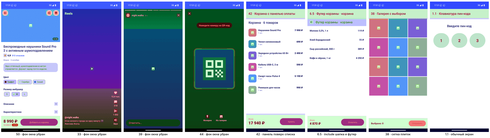

**Item 50 in numbers:** body = one flat `ConstraintLayout` (its only container children are the two
chip groups and the pager); slider pages are single `ImageView`s; the toolbar and the bottom bar
are siblings of the `ScrollView`, not inside it; the root's background is the only full-screen paint.

## Answer to 5.5: why not a list inside a ScrollView

1. **Recycling breaks.** A vertical `ScrollView` measures its child with unbounded height, so a
   `RecyclerView` in it lays out every item at once: a thousand rows means a thousand views in memory
   and a slow first frame. A `ListView` does not even know its height and shows one or two rows.
2. **Two containers fight over one gesture.** Both want the same vertical drag; which one gets it
   depends on where the touch started, so scrolling stutters, stops at the list's edge and flings badly.
3. **Every change re-measures everything.** Updating the inner list re-measures the whole scroll view.

The right way: one scrolling `RecyclerView` with the header, banners and the rest as other view types
(`getItemViewType` or `ConcatAdapter`). Nesting is fine only across directions — a horizontal
carousel inside a vertical feed (as in 5.1, 10, 11, 24).

## Item index

Generated from the sources. *Containers* lists the layout elements used; *Depth / views* is measured
on the device; *Verified by* links each item to the tests that check what it asks for — every one of
the 81 screens has at least one besides `SmokeTest`, which opens them all.

### Topic exercises (30)

| Item | Title | Layout | Containers | Depth / views | Verified by |
|---|---|---|---|---|---|
| 1.1 | Клавиатура пин-кода | [`t1_1_pin_row.xml`](../../task5/src/main/res/layout/t1_1_pin_row.xml) | LinearLayout | 2 / 6 | [`t1_1_pinButtonsShareTheRowAndAreRound`](../../task5/src/androidTest/java/dev/yorushi/dma/task5/LayoutTest.java#L40) |
| 1.2 | Сплит-экран 50/50 | [`t1_2_split.xml`](../../task5/src/main/res/layout/t1_2_split.xml) | LinearLayout | 1 / 3 | [`t1_2_halvesAreEqual`](../../task5/src/androidTest/java/dev/yorushi/dma/task5/LayoutTest.java#L52) |
| 1.3 | Поле поиска с кнопкой | [`t1_3_search.xml`](../../task5/src/main/res/layout/t1_3_search.xml) | LinearLayout | 1 / 3 | [`t1_3_fieldTakesWhatTheIconLeaves`](../../task5/src/androidTest/java/dev/yorushi/dma/task5/LayoutTest.java#L58) |
| 1.4 | Центрирование заголовка | [`t1_4_titles.xml`](../../task5/src/main/res/layout/t1_4_titles.xml) | LinearLayout | 1 / 4 | [`t1_4_titleCentredSubtitleAtTheEnd`](../../task5/src/androidTest/java/dev/yorushi/dma/task5/LayoutTest.java#L69) |
| 1.5 | Форма входа с разделителем | [`t1_5_login.xml`](../../task5/src/main/res/layout/t1_5_login.xml) | LinearLayout | 2 / 7 | [`t1_5_dividerIsOneDp`](../../task5/src/androidTest/java/dev/yorushi/dma/task5/LayoutTest.java#L80) |
| 2.1 | Аватар с бейджем «Онлайн» | [`t2_1_avatar_badge.xml`](../../task5/src/main/res/layout/t2_1_avatar_badge.xml) | LinearLayout, FrameLayout | 2 / 7 | [`t2_1_badgeInTheAvatarsBottomEndCorner`](../../task5/src/androidTest/java/dev/yorushi/dma/task5/LayoutTest.java#L88) |
| 2.2 | Кнопка с оверлеем блокировки | [`t2_2_button_overlay.xml`](../../task5/src/main/res/layout/t2_2_button_overlay.xml) | LinearLayout, FrameLayout | 2 / 6 | [`t2_2_buttonLockedWhileSending`](../../task5/src/androidTest/java/dev/yorushi/dma/task5/BehaviorTest.java#L55) |
| 2.3 | Плавающая кнопка действия | [`t2_3_fab.xml`](../../task5/src/main/res/layout/t2_3_fab.xml) | FrameLayout, ScrollView | 2 / 4 | [`t2_3_fabFloatsInTheCorner`](../../task5/src/androidTest/java/dev/yorushi/dma/task5/LayoutTest.java#L98) |
| 2.4 | Контейнер под фрагмент | [`t2_4_fragment_container.xml`](../../task5/src/main/res/layout/t2_4_fragment_container.xml) | LinearLayout, FrameLayout | 2 / 4 | [`t2_4_fragmentInTheContainer`](../../task5/src/androidTest/java/dev/yorushi/dma/task5/BehaviorTest.java#L69) |
| 2.5 | Видео-превью с иконкой Play | [`t2_5_video_preview.xml`](../../task5/src/main/res/layout/t2_5_video_preview.xml) | LinearLayout, FrameLayout | 2 / 5 | [`t2_5_playIconCentred`](../../task5/src/androidTest/java/dev/yorushi/dma/task5/LayoutTest.java#L108) |
| 3.1 | Чат-сообщение со временем | [`t3_1_chat_bubble.xml`](../../task5/src/main/res/layout/t3_1_chat_bubble.xml) | RelativeLayout | 1 / 3 | [`t3_1_timeAtTheBottomRightOfTheText`](../../task5/src/androidTest/java/dev/yorushi/dma/task5/LayoutTest.java#L120) |
| 3.2 | Шапка экрана (TopAppBar) | [`t3_2_top_bar.xml`](../../task5/src/main/res/layout/t3_2_top_bar.xml) | RelativeLayout | 1 / 4 | [`t3_2_titleCentredBetweenEdgeButtons`](../../task5/src/androidTest/java/dev/yorushi/dma/task5/LayoutTest.java#L130) |
| 3.3 | Карточка товара в каталоге | [`t3_3_product.xml`](../../task5/src/main/res/layout/t3_3_product.xml) | RelativeLayout | 1 / 4 | [`t3_3_priceSitsOnThePhotosBottom`](../../task5/src/androidTest/java/dev/yorushi/dma/task5/LayoutTest.java#L141) |
| 3.4 | Элемент списка музыки | [`t3_4_music_item.xml`](../../task5/src/main/res/layout/t3_4_music_item.xml) | RelativeLayout | 1 / 5 | [`t3_4_textBetweenCoverAndHeart`](../../task5/src/androidTest/java/dev/yorushi/dma/task5/LayoutTest.java#L528) |
| 3.5 | Выравнивание по базовой линии | [`t3_5_baseline.xml`](../../task5/src/main/res/layout/t3_5_baseline.xml) | RelativeLayout | 1 / 4 | [`t3_5_sameBaseline`](../../task5/src/androidTest/java/dev/yorushi/dma/task5/LayoutTest.java#L150) |
| 4.1 | Баннер 16:9 | [`t4_1_ratio_banner.xml`](../../task5/src/main/res/layout/t4_1_ratio_banner.xml) | ConstraintLayout | 1 / 3 | [`t4_1_bannerIsSixteenByNine`](../../task5/src/androidTest/java/dev/yorushi/dma/task5/LayoutTest.java#L161) |
| 4.2 | Упакованная цепочка | [`t4_2_packed_chain.xml`](../../task5/src/main/res/layout/t4_2_packed_chain.xml) | ConstraintLayout | 1 / 3 | [`t4_2_chainBiasedToTheTop`](../../task5/src/androidTest/java/dev/yorushi/dma/task5/LayoutTest.java#L170) |
| 4.3 | Ограничитель (Barrier) | [`t4_3_barrier.xml`](../../task5/src/main/res/layout/t4_3_barrier.xml) | ConstraintLayout, Barrier | 1 / 10 | [`t4_3_buttonFollowsTheLongerLabel`](../../task5/src/androidTest/java/dev/yorushi/dma/task5/LayoutTest.java#L183) |
| 4.4 | Процентное позиционирование | [`t4_4_guidelines.xml`](../../task5/src/main/res/layout/t4_4_guidelines.xml) | ConstraintLayout, Guideline | 1 / 5 | [`t4_4_buttonFrom15To85Percent`](../../task5/src/androidTest/java/dev/yorushi/dma/task5/LayoutTest.java#L196) |
| 4.5 | Групповое управление видимостью | [`t4_5_group.xml`](../../task5/src/main/res/layout/t4_5_group.xml) | ConstraintLayout, Group | 1 / 7 | [`t4_5_oneCallHidesTheGroup`](../../task5/src/androidTest/java/dev/yorushi/dma/task5/BehaviorTest.java#L76) |
| 5.1 | Лента историй (Stories) | [`t5_1_stories.xml`](../../task5/src/main/res/layout/t5_1_stories.xml) | LinearLayout, HorizontalScrollView | 3 / 13 | [`t5_1_storiesAreWiderThanTheScreen`](../../task5/src/androidTest/java/dev/yorushi/dma/task5/LayoutTest.java#L208) |
| 5.2 | Лицензионное соглашение | [`t5_2_license.xml`](../../task5/src/main/res/layout/t5_2_license.xml) | LinearLayout, ScrollView | 3 / 6 | [`t5_2_buttonOutsideTheScroll`](../../task5/src/androidTest/java/dev/yorushi/dma/task5/LayoutTest.java#L214) |
| 5.3 | Форма с защитой от клавиатуры | [`t5_3_keyboard_form.xml`](../../task5/src/main/res/layout/t5_3_keyboard_form.xml) | ScrollView, LinearLayout | 6 / 52 | [`t5_3_windowResizesForTheKeyboard`](../../task5/src/androidTest/java/dev/yorushi/dma/task5/LayoutTest.java#L542) |
| 5.4 | Скрытие полосы прокрутки | [`t5_4_no_scrollbar.xml`](../../task5/src/main/res/layout/t5_4_no_scrollbar.xml) | LinearLayout, ScrollView | 3 / 24 | [`t5_4_noScrollbar`](../../task5/src/androidTest/java/dev/yorushi/dma/task5/LayoutTest.java#L226) |
| 5.5 | Вложенность списков | [`t5_5_nested_lists.xml`](../../task5/src/main/res/layout/t5_5_nested_lists.xml) | ScrollView | 1 / 2 | [`t5_5_answerIsThereAndScrolls`](../../task5/src/androidTest/java/dev/yorushi/dma/task5/LayoutTest.java#L551) |
| 6.1 | Единая шапка (include) | [`t6_1_include_toolbar.xml`](../../task5/src/main/res/layout/t6_1_include_toolbar.xml) | LinearLayout, include | 2 / 5 | [`t6_1_sharedToolbarOnFourScreens`](../../task5/src/androidTest/java/dev/yorushi/dma/task5/LayoutTest.java#L237) |
| 6.2 | Составная карточка на merge | [`t6_2_merge_card.xml`](../../task5/src/main/res/layout/t6_2_merge_card.xml) | LinearLayout | 2 / 11 | [`t6_2_mergeAddsNoExtraLevel`](../../task5/src/androidTest/java/dev/yorushi/dma/task5/LayoutTest.java#L249) |
| 6.3 | Ленивый экран ошибки (ViewStub) | [`t6_3_view_stub.xml`](../../task5/src/main/res/layout/t6_3_view_stub.xml) | LinearLayout, include, ViewStub | 2 / 7 | [`t6_1_sharedToolbarOnFourScreens`](../../task5/src/androidTest/java/dev/yorushi/dma/task5/LayoutTest.java#L237)<br>[`t6_3_stubInflatedOnDemand`](../../task5/src/androidTest/java/dev/yorushi/dma/task5/BehaviorTest.java#L89)<br>[`t6_3_stubIsNotInflatedUntilNeeded`](../../task5/src/androidTest/java/dev/yorushi/dma/task5/LayoutTest.java#L259) |
| 6.4 | Переопределение параметров include | [`t6_4_include_override.xml`](../../task5/src/main/res/layout/t6_4_include_override.xml) | LinearLayout, include | 3 / 12 | [`t6_4_includeParamsOverridden`](../../task5/src/androidTest/java/dev/yorushi/dma/task5/LayoutTest.java#L267) |
| 6.5 | Футер корзины · корзина | [`t6_5_cart.xml`](../../task5/src/main/res/layout/t6_5_cart.xml) | LinearLayout, include, ScrollView, RelativeLayout | 4 / 23 | [`t6_1_sharedToolbarOnFourScreens`](../../task5/src/androidTest/java/dev/yorushi/dma/task5/LayoutTest.java#L237)<br>[`t6_5_sameFooterOnBothScreens`](../../task5/src/androidTest/java/dev/yorushi/dma/task5/LayoutTest.java#L279) |
| 6.5 | Футер корзины · повторный заказ | [`t6_5_reorder.xml`](../../task5/src/main/res/layout/t6_5_reorder.xml) | LinearLayout, include, ScrollView, RelativeLayout | 4 / 24 | [`t6_1_sharedToolbarOnFourScreens`](../../task5/src/androidTest/java/dev/yorushi/dma/task5/LayoutTest.java#L237)<br>[`t6_5_sameFooterOnBothScreens`](../../task5/src/androidTest/java/dev/yorushi/dma/task5/LayoutTest.java#L279) |

### Block 1 · catalogue, product and service cards (1–10)

| Item | Title | Layout | Containers | Depth / views | Verified by |
|---|---|---|---|---|---|
| 1 | Карточка маркетплейса | [`m01_marketplace.xml`](../../task5/src/main/res/layout/m01_marketplace.xml) | LinearLayout, include | 3 / 17 | [`m01_photoSquareBadgeInTheCorner`](../../task5/src/androidTest/java/dev/yorushi/dma/task5/LayoutTest.java#L292) |
| 2 | Карточка ресторана доставки | [`m02_restaurant.xml`](../../task5/src/main/res/layout/m02_restaurant.xml) | ConstraintLayout | 1 / 8 | [`m02_logoStartHeartTopEnd`](../../task5/src/androidTest/java/dev/yorushi/dma/task5/LayoutTest.java#L560) |
| 3 | Баннер спецпредложения | [`m03_promo_banner.xml`](../../task5/src/main/res/layout/m03_promo_banner.xml) | ConstraintLayout | 1 / 7 | [`m03_artSticksOutOfTheCard`](../../task5/src/androidTest/java/dev/yorushi/dma/task5/LayoutTest.java#L304) |
| 4 | Карточка банковской карты | [`m04_bank_card.xml`](../../task5/src/main/res/layout/m04_bank_card.xml) | ConstraintLayout | 1 / 10 | [`m04_cardIs85By54`](../../task5/src/androidTest/java/dev/yorushi/dma/task5/LayoutTest.java#L310) |
| 5 | Сетка параметров автомобиля | [`m05_car_specs.xml`](../../task5/src/main/res/layout/m05_car_specs.xml) | ConstraintLayout, Guideline, Barrier | 1 / 19 | [`m05_specGridIsFlat`](../../task5/src/androidTest/java/dev/yorushi/dma/task5/LayoutTest.java#L320) |
| 6 | Карточка авиабилета | [`m06_flight_ticket.xml`](../../task5/src/main/res/layout/m06_flight_ticket.xml) | ConstraintLayout | 1 / 12 | [`m06_planeCentredOverTheDashedLine`](../../task5/src/androidTest/java/dev/yorushi/dma/task5/LayoutTest.java#L572) |
| 7 | Компактная карточка трека | [`m07_track.xml`](../../task5/src/main/res/layout/m07_track.xml) | ConstraintLayout | 1 / 7 | [`m07_badgeGluedToTheTitle`](../../task5/src/androidTest/java/dev/yorushi/dma/task5/LayoutTest.java#L584) |
| 8 | Карточка тарифа связи | [`m08_tariff.xml`](../../task5/src/main/res/layout/m08_tariff.xml) | ConstraintLayout | 1 / 11 | [`m08_feeFollowsTheSliders`](../../task5/src/androidTest/java/dev/yorushi/dma/task5/BehaviorTest.java#L103)<br>[`m08_tariffFee`](../../task5/src/test/java/dev/yorushi/dma/task5/logic/LogicTest.java#L79) |
| 9 | Карточка подписки со скидкой | [`m09_subscription.xml`](../../task5/src/main/res/layout/m09_subscription.xml) | FrameLayout, LinearLayout | 2 / 9 | [`m09_hitLabelSitsOnTheBorder`](../../task5/src/androidTest/java/dev/yorushi/dma/task5/LayoutTest.java#L329) |
| 10 | Карточка бронирования отеля | [`m10_hotel.xml`](../../task5/src/main/res/layout/m10_hotel.xml) | LinearLayout, HorizontalScrollView, ConstraintLayout | 3 / 13 | [`m10_threePhotosInACarousel`](../../task5/src/androidTest/java/dev/yorushi/dma/task5/LayoutTest.java#L594) |

### Block 2 · forms, filters and settings (11–20)

| Item | Title | Layout | Containers | Depth / views | Verified by |
|---|---|---|---|---|---|
| 11 | Перевод по номеру телефона | [`m11_phone_transfer.xml`](../../task5/src/main/res/layout/m11_phone_transfer.xml) | ScrollView, LinearLayout, HorizontalScrollView, ChipGroup | 6 / 38 | [`m11_quickSumFillsTheAmount`](../../task5/src/androidTest/java/dev/yorushi/dma/task5/BehaviorTest.java#L115) |
| 12 | Сложный фильтр каталога | [`m12_filter.xml`](../../task5/src/main/res/layout/m12_filter.xml) | LinearLayout, ChipGroup | 6 / 36 | [`m12_fieldsAndSliderStayInSync`](../../task5/src/androidTest/java/dev/yorushi/dma/task5/BehaviorTest.java#L124)<br>[`m12_rangeFromTypedText`](../../task5/src/test/java/dev/yorushi/dma/task5/logic/LogicTest.java#L86) |
| 13 | Смена пароля | [`m13_password.xml`](../../task5/src/main/res/layout/m13_password.xml) | ScrollView, LinearLayout | 6 / 41 | [`m13_rulesLightUpAsYouType`](../../task5/src/androidTest/java/dev/yorushi/dma/task5/BehaviorTest.java#L145)<br>[`m13_passwordRulesOneByOne`](../../task5/src/test/java/dev/yorushi/dma/task5/logic/LogicTest.java#L14)<br>[`m13_emptyPasswordsDoNotCountAsMatching`](../../task5/src/test/java/dev/yorushi/dma/task5/logic/LogicTest.java#L25) |
| 14 | Адрес доставки | [`m14_address.xml`](../../task5/src/main/res/layout/m14_address.xml) | LinearLayout | 6 / 81 | [`m14_houseRowIsOneOneOneOne`](../../task5/src/androidTest/java/dev/yorushi/dma/task5/LayoutTest.java#L338) |
| 15 | Форма отзыва | [`m15_review.xml`](../../task5/src/main/res/layout/m15_review.xml) | LinearLayout | 5 / 21 | [`m15_starsCentredBigComment`](../../task5/src/androidTest/java/dev/yorushi/dma/task5/LayoutTest.java#L605) |
| 16 | Настройки приватности | [`m16_privacy.xml`](../../task5/src/main/res/layout/m16_privacy.xml) | LinearLayout, ConstraintLayout | 2 / 22 | [`m16_switchesNeverCoverTheText`](../../task5/src/androidTest/java/dev/yorushi/dma/task5/LayoutTest.java#L614) |
| 17 | Данные кредитной карты | [`m17_card_input.xml`](../../task5/src/main/res/layout/m17_card_input.xml) | LinearLayout, FrameLayout | 3 / 13 | [`m17_cvcOnTheUncoveredBack`](../../task5/src/androidTest/java/dev/yorushi/dma/task5/LayoutTest.java#L631) |
| 18 | Форма обратной связи | [`m18_feedback.xml`](../../task5/src/main/res/layout/m18_feedback.xml) | LinearLayout, ConstraintLayout | 5 / 32 | [`m18_attachmentRowAppears`](../../task5/src/androidTest/java/dev/yorushi/dma/task5/BehaviorTest.java#L158) |
| 19 | Код из SMS | [`m19_sms_code.xml`](../../task5/src/main/res/layout/m19_sms_code.xml) | ConstraintLayout, LinearLayout | 2 / 11 | [`m19_cellsCentred`](../../task5/src/androidTest/java/dev/yorushi/dma/task5/LayoutTest.java#L348)<br>[`m19_focusMovesOnAndBack`](../../task5/src/androidTest/java/dev/yorushi/dma/task5/BehaviorTest.java#L168) |
| 20 | Редактирование профиля | [`m20_profile_edit.xml`](../../task5/src/main/res/layout/m20_profile_edit.xml) | ScrollView, LinearLayout, FrameLayout | 6 / 53 | [`m20_cameraOnThePhotosCorner`](../../task5/src/androidTest/java/dev/yorushi/dma/task5/LayoutTest.java#L644) |

### Block 3 · profiles, dashboards and statistics (21–30)

| Item | Title | Layout | Containers | Depth / views | Verified by |
|---|---|---|---|---|---|
| 21 | Шапка профиля соцсети | [`m21_profile_header.xml`](../../task5/src/main/res/layout/m21_profile_header.xml) | ConstraintLayout | 1 / 11 | [`m21_countersHaveEqualWeights`](../../task5/src/androidTest/java/dev/yorushi/dma/task5/LayoutTest.java#L359) |
| 22 | Дашборд фитнес-трекера | [`m22_fitness.xml`](../../task5/src/main/res/layout/m22_fitness.xml) | ConstraintLayout | 1 / 9 | [`m22_stepsCentredInTheRing`](../../task5/src/androidTest/java/dev/yorushi/dma/task5/LayoutTest.java#L368) |
| 23 | Баланс кошелька | [`m23_wallet.xml`](../../task5/src/main/res/layout/m23_wallet.xml) | ConstraintLayout | 1 / 19 | [`m23_balanceHides`](../../task5/src/androidTest/java/dev/yorushi/dma/task5/BehaviorTest.java#L181) |
| 24 | Сводка аналитики продаж | [`m24_analytics.xml`](../../task5/src/main/res/layout/m24_analytics.xml) | LinearLayout, HorizontalScrollView | 4 / 23 | [`m24_chartAndScrollableMetrics`](../../task5/src/androidTest/java/dev/yorushi/dma/task5/LayoutTest.java#L654) |
| 25 | Статистика батареи | [`m25_battery.xml`](../../task5/src/main/res/layout/m25_battery.xml) | ScrollView, LinearLayout, ConstraintLayout | 4 / 35 | [`m25_fillIsTheChargeLevel`](../../task5/src/androidTest/java/dev/yorushi/dma/task5/LayoutTest.java#L379) |
| 26 | Достижения | [`m26_achievements.xml`](../../task5/src/main/res/layout/m26_achievements.xml) | LinearLayout, SquareFrameLayout | 3 / 37 | [`m26_lockedBadgesWearALock`](../../task5/src/androidTest/java/dev/yorushi/dma/task5/LayoutTest.java#L389) |
| 27 | Визитка водителя такси | [`m27_driver.xml`](../../task5/src/main/res/layout/m27_driver.xml) | ConstraintLayout | 1 / 10 | [`m27_ratingHangsOffThePhoto`](../../task5/src/androidTest/java/dev/yorushi/dma/task5/LayoutTest.java#L664) |
| 28 | История заказов | [`m28_orders.xml`](../../task5/src/main/res/layout/m28_orders.xml) | ScrollView, LinearLayout, ConstraintLayout | 4 / 29 | [`m28_statusOnTheDatesLine`](../../task5/src/androidTest/java/dev/yorushi/dma/task5/LayoutTest.java#L676) |
| 29 | Умный дом | [`m29_smart_home.xml`](../../task5/src/main/res/layout/m29_smart_home.xml) | ScrollView, LinearLayout, SquareFrameLayout | 4 / 36 | [`m29_tilesAreEqualSquares`](../../task5/src/androidTest/java/dev/yorushi/dma/task5/LayoutTest.java#L399) |
| 30 | Медицинская карта | [`m30_medical.xml`](../../task5/src/main/res/layout/m30_medical.xml) | ScrollView, LinearLayout, ConstraintLayout, ChipGroup, RelativeLayout | 3 / 24 | [`m30_tagsWrap`](../../task5/src/androidTest/java/dev/yorushi/dma/task5/LayoutTest.java#L409) |

### Block 4 · media players, chats and social screens (31–40)

| Item | Title | Layout | Containers | Depth / views | Verified by |
|---|---|---|---|---|---|
| 31 | Аудиоплеер | [`m31_player.xml`](../../task5/src/main/res/layout/m31_player.xml) | ConstraintLayout | 1 / 12 | [`m31_marqueeRunsAndPlayToggles`](../../task5/src/androidTest/java/dev/yorushi/dma/task5/BehaviorTest.java#L192) |
| 32 | Диалог мессенджера | [`m32_chat.xml`](../../task5/src/main/res/layout/m32_chat.xml) | LinearLayout, ScrollView | 4 / 18 | [`m32_bubblesOnTheirSides`](../../task5/src/androidTest/java/dev/yorushi/dma/task5/LayoutTest.java#L419) |
| 33 | Короткие видео (Reels) | [`m33_reels.xml`](../../task5/src/main/res/layout/m33_reels.xml) | FrameLayout, LinearLayout | 2 / 12 | [`m33_actionsDownTheRightEdge`](../../task5/src/androidTest/java/dev/yorushi/dma/task5/LayoutTest.java#L430) |
| 34 | Голосовой вызов | [`m34_call.xml`](../../task5/src/main/res/layout/m34_call.xml) | FrameLayout, ConstraintLayout | 2 / 12 | [`m34_avatarCentredButtonsBelow`](../../task5/src/androidTest/java/dev/yorushi/dma/task5/LayoutTest.java#L687) |
| 35 | Лента комментариев | [`m35_comments.xml`](../../task5/src/main/res/layout/m35_comments.xml) | ScrollView, LinearLayout, ConstraintLayout | 3 / 29 | [`m35_repliesAreIndented`](../../task5/src/androidTest/java/dev/yorushi/dma/task5/LayoutTest.java#L440) |
| 36 | Видеоплеер с управлением | [`m36_video_controls.xml`](../../task5/src/main/res/layout/m36_video_controls.xml) | ConstraintLayout, Group | 1 / 10 | [`m36_controlsOnTheVideoEdges`](../../task5/src/androidTest/java/dev/yorushi/dma/task5/LayoutTest.java#L451)<br>[`m36_tapTogglesTheControls`](../../task5/src/androidTest/java/dev/yorushi/dma/task5/BehaviorTest.java#L202) |
| 37 | Запись голосового сообщения | [`m37_voice_record.xml`](../../task5/src/main/res/layout/m37_voice_record.xml) | ConstraintLayout | 1 / 8 | [`m37_swipeLeftCancelsTheRecording`](../../task5/src/androidTest/java/dev/yorushi/dma/task5/BehaviorTest.java#L241)<br>[`m37_m47_timerFormat`](../../task5/src/test/java/dev/yorushi/dma/task5/logic/LogicTest.java#L61) |
| 38 | Галерея с выбором | [`m38_gallery.xml`](../../task5/src/main/res/layout/m38_gallery.xml) | LinearLayout, ScrollView, SquareFrameLayout | 5 / 46 | [`m38_photosNumberedInPickOrder`](../../task5/src/androidTest/java/dev/yorushi/dma/task5/BehaviorTest.java#L253)<br>[`m38_selectionIsNumberedInPickOrder`](../../task5/src/test/java/dev/yorushi/dma/task5/logic/LogicTest.java#L34)<br>[`m38_unpickingRenumbersTheRest`](../../task5/src/test/java/dev/yorushi/dma/task5/logic/LogicTest.java#L47) |
| 39 | Stories со статус-барами | [`m39_stories.xml`](../../task5/src/main/res/layout/m39_stories.xml) | FrameLayout, LinearLayout, ConstraintLayout | 2 / 15 | [`m39_segmentsSplitEqually`](../../task5/src/androidTest/java/dev/yorushi/dma/task5/LayoutTest.java#L462) |
| 40 | Превью подкаста | [`m40_podcast.xml`](../../task5/src/main/res/layout/m40_podcast.xml) | LinearLayout, ConstraintLayout | 2 / 16 | [`m40_playsInsideTheFeed`](../../task5/src/androidTest/java/dev/yorushi/dma/task5/BehaviorTest.java#L270) |

### Block 5 · composite screens with overlays (41–50)

| Item | Title | Layout | Containers | Depth / views | Verified by |
|---|---|---|---|---|---|
| 41 | Такси с картой | [`m41_taxi.xml`](../../task5/src/main/res/layout/m41_taxi.xml) | CoordinatorLayout, ConstraintLayout, LinearLayout | 4 / 26 | [`m41_oneTariffAtATime`](../../task5/src/androidTest/java/dev/yorushi/dma/task5/BehaviorTest.java#L281) |
| 42 | Корзина с панелью оплаты | [`m42_cart_bar.xml`](../../task5/src/main/res/layout/m42_cart_bar.xml) | FrameLayout, ScrollView, LinearLayout, ConstraintLayout | 4 / 39 | [`m42_panelFixedListScrollsUnderIt`](../../task5/src/androidTest/java/dev/yorushi/dma/task5/LayoutTest.java#L473) |
| 43 | Онбординг | [`m43_onboarding.xml`](../../task5/src/main/res/layout/m43_onboarding.xml) | ConstraintLayout, LinearLayout | 2 / 10 | [`m43_artIsFortyPercent`](../../task5/src/androidTest/java/dev/yorushi/dma/task5/LayoutTest.java#L483) |
| 44 | Сканер QR-кода | [`m44_qr.xml`](../../task5/src/main/res/layout/m44_qr.xml) | FrameLayout, LinearLayout | 2 / 8 | [`m44_windowIsACentredSquare`](../../task5/src/androidTest/java/dev/yorushi/dma/task5/LayoutTest.java#L489) |
| 45 | Пустое состояние | [`m45_empty_state.xml`](../../task5/src/main/res/layout/m45_empty_state.xml) | ConstraintLayout | 1 / 5 | [`m45_blockCentred`](../../task5/src/androidTest/java/dev/yorushi/dma/task5/LayoutTest.java#L498) |
| 46 | Результаты квиза | [`m46_quiz_result.xml`](../../task5/src/main/res/layout/m46_quiz_result.xml) | FrameLayout, ConstraintLayout | 2 / 12 | [`m46_confettiIsATopLayerThatLetsTouchesThrough`](../../task5/src/androidTest/java/dev/yorushi/dma/task5/LayoutTest.java#L701) |
| 47 | Подтверждение операции | [`m47_confirm_otp.xml`](../../task5/src/main/res/layout/m47_confirm_otp.xml) | ConstraintLayout | 5 / 18 | [`m47_resendLockedWhileTheCodeIsValid`](../../task5/src/androidTest/java/dev/yorushi/dma/task5/BehaviorTest.java#L299)<br>[`m37_m47_timerFormat`](../../task5/src/test/java/dev/yorushi/dma/task5/logic/LogicTest.java#L61)<br>[`m47_secondsLeftRoundUpUntilTheEnd`](../../task5/src/test/java/dev/yorushi/dma/task5/logic/LogicTest.java#L70) |
| 48 | Сравнение двух товаров | [`m48_compare.xml`](../../task5/src/main/res/layout/m48_compare.xml) | ScrollView, ConstraintLayout, Guideline | 2 / 29 | [`m48_dividerAtHalf`](../../task5/src/androidTest/java/dev/yorushi/dma/task5/LayoutTest.java#L508) |
| 49 | Оформление страховки | [`m49_insurance.xml`](../../task5/src/main/res/layout/m49_insurance.xml) | LinearLayout, ScrollView | 7 / 77 | [`m49_onlyTheFormScrolls`](../../task5/src/androidTest/java/dev/yorushi/dma/task5/LayoutTest.java#L517)<br>[`m49_stepsForwardAndBack`](../../task5/src/androidTest/java/dev/yorushi/dma/task5/BehaviorTest.java#L312) |
| 50 | Детальная страница товара | [`m50_product.xml`](../../task5/src/main/res/layout/m50_product.xml) | FrameLayout, ScrollView, ConstraintLayout, ViewPager2, ChipGroup, LinearLayout | 5 / 36 | [`m50_productionArchitecture`](../../task5/src/androidTest/java/dev/yorushi/dma/task5/LayoutTest.java#L713)<br>[`m50_sliderAndAccordion`](../../task5/src/androidTest/java/dev/yorushi/dma/task5/BehaviorTest.java#L326) |
